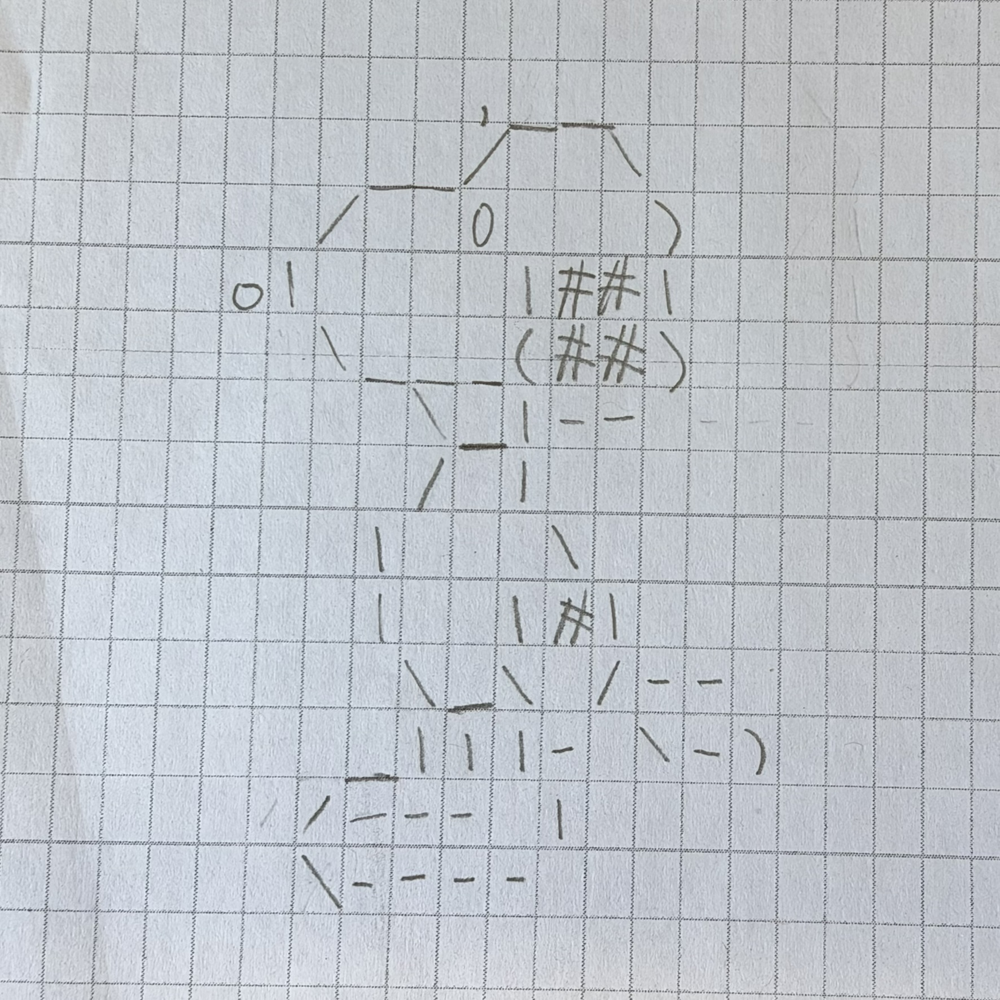
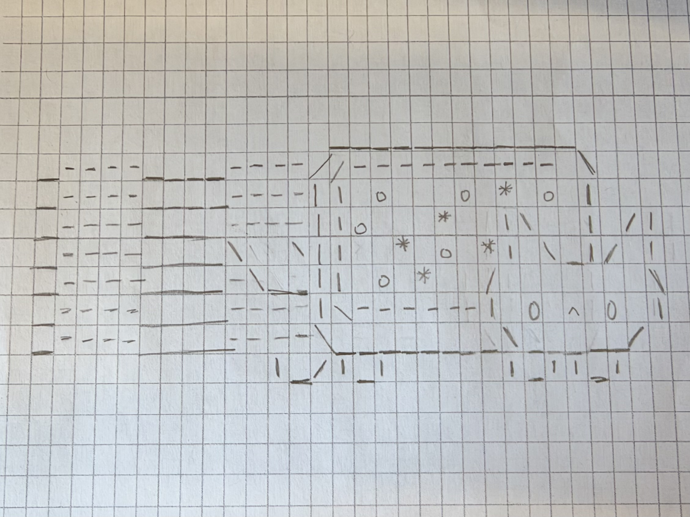

## Snoopy

My first ASCII still life art is a drawing of Snoopy from Peanuts. I was inspired to make this by a classmate, who was doing Woodstock.

First, I used a found a picture of Snoopy from the internet and translated it into ASCII on a grid. 



Then, I input each individual character into its 2D location in the `drawDog()` function. 
The final result looks like this:

```
       ,_____    
   ____/     \   
  /     0     )  
o|        |## |  
  \_______(## )  
       \__|---   
       /  |      
      |    \     
      |   |#|    
       \  \ /--- 
      _|| |- \--)
    /----  |     
    \------/     
JZ
```

Citation Points: 1

## Nyan Cat

For my second ASCII still life drawing, I did the Nyan Cat. I wasn't inspired by anything to make this, since it just popped into my head. 

Similar to my process with making Snoopy, I found a picture of the Nyan Cat on the internet, and translated it into ASCII on a grid. 



Then, I input each individual character into its 2D location in the `drawCat()` function. 
The final result looks like this:

```
              _____________________      
_----____----/ /_________________\ \     
_----____----| | o     o      o  | |     
_----____----| |    o     *   | \| |   /|
_----____\  \| |  *    *    o || \_|_ / |
_----____-\__| |     o    o   /         \
_----____----| |______________| 0  ^  0 |
_----____----\_________________\_______/ 
          |__/ |__|          |__|  |__|  
JZ
```

Citation Points: 1
